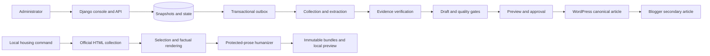

# Wisdome Super Writer service analysis

## Analysis baseline

| Item | Current value |
| --- | --- |
| Updated | 2026-10-10, Asia/Seoul; current source, saved data, scoped tests and release blockers revalidated; October 9 browser/live evidence remains historical |
| Branch/source | codex/policy-funding at db5edec35aad39ae85e3aca7b6f9e1b9f2e3a0dc plus funding, portal and monthly working changes; earlier work preserved |
| Commit | 2026-10-04; fix: address two-round code and service review findings (contains the 2026-10-03 repairs) |
| Latest evidence | [October 10 revalidation below](#2026-10-10-current-state-revalidation); [October 8–9 monthly acceptance](analysis/2026-10-08-monthly-data-update.md) and [October 5 review](analysis/2026-10-05-documentation-and-code-review.md) retain their original dates |
| Initial state | October 10 began with 18 modified tracked files and 53 untracked status entries, including existing funding/portal/monthly work. All were preserved. The original October 3 analysis began clean. |
| Scope | Current service and code status, saved October observations, local runtime/schema, focused regressions and selected historical distributed defects; earlier whole-domain review coverage is historical |
| Review method | October 10: one agent, current source reads, AST inventory, saved-data rendering and existing tests/probes. Historical method: two groups of three reviewers with main verification/repair. |
| Companion | [Code analysis](code-analysis.md) |
| Current evidence | [Monthly repair review](analysis/2026-10-08-monthly-update-review.md); historical [two-round adjudication](analysis/2026-10-03-two-round-review.md) preserved |
| Continuation | [English modification plan](superpowers/plans/2026-10-03-critical-review-remediation.md); plan authored, implementation tasks remain open |

## 2026-10-10 current-state revalidation

**Current assessment:** The three-topic local information portal has implemented,
tested browsing and period selection. Unattended distributed publishing is not
accepted for operation. The active local SQLite database also lacks all 71
migrations, so saved metadata is readable while database-backed drafts are
unavailable. A separate fresh SQLite accepted all 71 migrations; that result does
not migrate or repair the active database.

The baseline remains `codex/policy-funding` at
`db5edec35aad39ae85e3aca7b6f9e1b9f2e3a0dc`, plus the existing uncommitted
funding, portal and monthly features. Commit-only review would omit those features.
Publishing, scheduling, evidence-task and collection-service files examined for
the historical defects still match HEAD after CRLF normalization. No product
code, dependency, task checkbox, source polling reservation or existing output was
changed for this analysis. Only the two canonical reports and their AGENTS entry
were refreshed. Scratch tests/migrations used isolated state.

| Area | Evidence checked on October 10 | Meaning and limitation |
| --- | --- | --- |
| Housing | Validated historical projection: 23 October notices, special supply 18 and first priority 21 with overlap; 175 distinct historical identities and 124 without the selected stage dates | Actual reception dates determine month membership; unknown/nonapplicable stages and partial detail coverage are preserved |
| Funding | 17 October postings; latest live generation `2026-10-08--run-fd18f61df3fc` has 93 records; five live runs included in the period projection | Saved posting/registration observations, not current eligibility, application availability or exhaustive coverage |
| Semiconductor | Two validated live October metadata records; MOTIR 1, SIA 1, Samsung successfully empty, KRX unsupported and SK hynix disabled | Original publication dates remain separate from capture dates; these are saved metadata, not published articles |
| Local pages | In-process root, housing, news, drafts and funding views return 200; four topic views contain year controls | Server rendering, not a new browser or physical-device acceptance |
| Draft availability | Active database has 71 pending migrations; projection has `drafts_available=False`; rendered page states that the draft store is unavailable | The existence of the local news archive does not establish operational draft-store readiness |
| Distributed work | All 16 R9 SQL shapes reproduced; R1, R7 and R13 reproduced with local doubles; R2 reread and still records a retry decision without dispatch | R9 is compiler evidence without a PostgreSQL connection; recovery probes are simulated local execution, not remote incidents |

Fresh verification used the existing Python 3.12 environment,
`WISDOME_ENVIRONMENT=development`, `WISDOME_RUNTIME_MODE=local` and
`PYTHONUTF8=1`. Inherited `LOCAL_STATE_ROOT`, `LOCAL_OBJECT_ROOT`,
`LOCAL_ARTICLE_ROOT` and obsolete `LOCAL_OUTPUT_ROOT` were removed for normal
checks/tests. Existing `.env.local` was preserved. The code report records the
reproducible test selection and diagnostic commands.

| Verification | Actual result |
| --- | --- |
| Focused portal/month/date/funding/storage tests, 19 modules | 468 passed in 51.64 seconds; exit 0 |
| Django `check`, then `makemigrations --check --dry-run` | No issues; no model changes detected; exit 0 |
| Ruff: local_content, policy_funding and portal | All checks passed; exit 0 |
| Whole-repository Ruff | Exit 1; 1,561 findings, including 1,065 E501; unchanged count from historical evidence |
| Python syntax/inventory | 381 files parsed: src 279 / 114,207 lines, tests 95 / 44,806 lines, scripts 7 / 1,105 lines |
| R9 diagnostic assertions | 16 passed in 1.58 seconds, confirming the bad query shapes remain |
| R1/R7/R13/R5 diagnostic assertions | Five passed in 24.40 seconds, confirming the tested defects remain; passing diagnostic assertions are not repaired behavior |
| Fresh disposable SQLite migration | All 71 migrations applied; subsequent `migrate --check` exit 0 confirms no pending migrations in the scratch database. Scratch log under `.local/reviews/analysis-2026-10-10/`; active database preserved |
| Documentation validation | Both canonical reports and AGENTS decode as UTF-8, have balanced fences and 106 resolving local links in total; `git diff --check` exit 0, with existing LF/CRLF warnings |

An initial Korean literal check in a PowerShell-to-Python probe returned false.
Explicit UTF-8 pipeline output reproduced the actual unavailable-draft message and
empty-state text. This was a probe encoding issue, not a reproduced UI defect.

**Priorities:** If the next deliverable is the local portal, back up and validate
the active database before a separately scoped migration/recovery task; decide
collection cadence, partial-source handling and backup ownership. For distributed
publishing, first repair and execute R9 on PostgreSQL with real transaction tests,
then R1/R13 recovery and R7 per-schedule isolation. Executing selective retries
(R2), Blogger/media ordering and the existing immutable-release/channel acceptance
gates remain required. Preserve uncommitted feature work and produce a reviewable
source baseline before release. These are recommendations, not changes made now.

Open product decisions remain the operator portal versus public service boundary,
the next supported local/distributed deliverable and required refresh/coverage
objectives. A source directory is not evidence of an active collector.

No full unit/integration suite, new live collection, browser interaction,
PostgreSQL service, Celery/Redis/S3 stack, publisher write, OCR/HWP corpus or
production deployment was executed today. October 9's 1,689-test full result and
Chrome acceptance remain dated historical evidence. This refresh samples selected
high-impact paths; AST parsing and focused tests do not constitute a new exhaustive
code or security audit.

Sources: [current routes](../src/wisdome_writer/urls.py),
[portal views](../src/wisdome_writer/portal/views.py),
[housing projection](../src/wisdome_writer/portal/housing.py),
[news projection](../src/wisdome_writer/portal/semiconductor.py),
[funding history](../src/apps/policy_funding/storage.py),
[publishing services](../src/apps/publishing/services.py),
[schedule scanning](../src/apps/scheduling/services.py),
[selective retry](../src/apps/collection/services.py) and
[local-only CI](../.github/workflows/quality.yml).

### Historical repair and review context

Main repaired demonstrated defects in collection, evidence, quality, credentials,
media, schedules, reports and local tooling; the repairs are committed as `db5edec`.
These conclusions describe that source, not a deployed production instance. Unfinished
withdrawal/visual integration, fresh immutable release approval and actual distributed
acceptance remain open. Reboot continuation confirms a distributed release blocker:
16 production queries still compile nullable outer joins with unqualified row locks
(R9). Unknown credential revocation locks its target (R1); run-level retry records
no execution (R2); Blogger with new media has a source-traced stale path (R3).
Ordinary policy ineligibility still starves later schedules (R7), and disconnect
can prevent canary cleanup IDs from being saved (R13). Those findings describe the earlier review baseline and remain separate from the
new funding module. The feature adds product code and public-source collection;
dependencies, old task checkboxes and external publication remain unchanged.

Starting references:
[README](../README.md), [task ledger](../specs/001-automated-content-publishing/tasks.md),
[feature specification](../specs/001-automated-content-publishing/spec.md),
[operations handoff](../specs/001-automated-content-publishing/T031_WORK_IN_PROGRESS.md),
and [dated local acceptance](acceptance/2026-08-28-live-housing-acceptance.md).
Their different dates and scopes are kept separate from current verification.

## Purpose and users

Wisdome Super Writer helps an administrator collect South Korean housing notices
and domestic/global semiconductor news, preserve evidence, prepare Korean articles,
review factual/editorial eligibility, and publish to WordPress and Google Blogger.
The distributed design uses WordPress as the canonical original and Blogger as
secondary distribution. A new policy-funding module collects Korean central/local
finance notices and provides beginner Korean explanations, source discovery and
dated claim verification. It is integrated into the same Django navigation, with
its own collection/storage schema and read-only pages.

A separate Windows local workflow collects recent ApplyHome/LH residential notices,
renders Markdown and original illustrative graphics, humanizes protected prose
through a sibling service, and previews immutable output. Local mode does not
externally publish. Administrative APIs require an active staff session; local
preview/status routes instead require a loopback client and are development tools.

## Reusable service introduction and positioning (2026-10-08)

**One-line introduction:** Wisdome Super Writer collects housing subscription
notices, semiconductor news and Korean policy-funding information, organizes the
material with its sources, and helps an operator prepare understandable content.

**Short introduction:** Important notices and industry announcements are spread
across many websites and often use unfamiliar terminology. Wisdome Super Writer
brings configured sources into a content-production workflow, retains the original
references, and helps an administrator turn the material into readable articles
and guides. Its policy-funding experience also explains loan types, guarantees,
costs, preparation and application stages in approachable Korean.

| Content area | What the service provides | Reader benefit |
| --- | --- | --- |
| Housing subscriptions | ApplyHome/LH collection paths, notice facts and schedules, article preparation and local preview | Read key conditions and return to the original notice |
| Semiconductor news | Configured domestic/global public-source adapters, official corporate/industry announcements and evidence-linked drafting | Follow industry information with attribution to the original source |
| Korean policy funding | Connected SEMAS/Bizinfo finance notices, regional source discovery, search, plain-language terms and application journeys | Understand the available support types and what to check before applying |

**Primary user:** An administrator or content operator researching and preparing
information for readers. People seeking housing, industry information or business
funding are the intended readers; source inspection does not establish a launched
public self-service product, a customer base or a confirmed paying audience.

**Core value:** Reduce repeated source gathering, make difficult notices easier
to understand, keep source links available, and reuse reviewed material as content.
These are functional value propositions, not measured time-saving or accuracy claims.
The shared narrative is collection, source-linked organization, explanation,
content preparation and review. Specific modules have different execution paths.

**Current delivery boundary:** The product is an administrator-oriented development
service. Housing and funding have local collection/output/preview paths. The
distributed service contains editorial, approval, scheduling and WordPress/Blogger
integration code; operational acceptance remains required. Local mode disables
external publishing, and the separate funding module currently produces local
documents/read-only pages. Do not imply that funding is already automatically
published through the older distributed pipeline.

**Messaging priorities:** Lead with the three topics and understandable information.
Describe sources and review steps in concrete terms. Funding explanations must keep
confirmation, approval, personal eligibility and disbursement distinct. The current
curriculum is reviewed content, including six conversational answers and 32 terms;
it is not an arbitrary-question financial advisor. Avoid claiming exhaustive national
coverage, continuously refreshed news, guaranteed approvals, universal automated fact
checking or unattended production publishing. Do not describe the deterministic
drafting adapter as a general-purpose LLM writing engine.

**Open positioning decisions:** Public-facing service versus operator tooling,
commercial model/pricing, priority reader segment and a public launch date remain
unconfirmed. No competitor ranking, customer testimonial or outcome metric is
introduced by this summary.

### Source check and verification limits for this refresh

- Date/baseline: 2026-10-08 Asia/Seoul; codex/policy-funding at
  db5edec35aad39ae85e3aca7b6f9e1b9f2e3a0dc with the existing uncommitted funding
  implementation and analysis changes. They were preserved.
- Re-read this canonical report, project/shared instructions, README, and the
  October 6 funding follow-up. No marketing-context file was present at the checked
  .agents/.claude canonical or legacy paths; this report remains the common authority.
- Commands: git status --short, git branch --show-current, git rev-parse HEAD,
  targeted rg searches and UTF-8 source reads. Confirmed the three enabled funding
  configurations, the guide/search routes, the semiconductor adapter registrations,
  and the deterministic article-generator boundary.
- Evidence: [source profiles](../src/apps/topics/services.py),
  [semiconductor adapters](../src/adapters/sources/semiconductor/adapters.py),
  [housing workflow](../src/apps/local_content/workflow.py),
  [article generator](../src/adapters/generators/template.py),
  [funding source catalog](../config/policy-funding/sources.json),
  [funding views](../src/apps/policy_funding/views.py),
  [funding workflow](../src/apps/policy_funding/workflow.py),
  [external publication policy](../src/wisdome_writer/external_publishing.py), and
  [dated funding explanation acceptance](analysis/2026-10-06-policy-funding-consultant-claims.md).
- This is a documentation/source-backed introduction refresh. No product code,
  collection, financial-term verification, runtime test, browser acceptance or
  production deployment was executed in this turn. Earlier test/live results keep
  their original dates; existing distributed findings were not re-adjudicated.
- Documentation validation: 52 local report links resolve; UTF-8 and Markdown
  fences are valid. git diff --check passes for README, AGENTS and this report.
- The Korean README introduction and the user-facing response use this positioning.
  Future introduction requests should refresh this section rather than create a
  competing service analysis.

## Architecture and runtime modes

### Three-topic operator portal

The root now renders a common portal rather than redirecting into the technical
operations console. Housing, semiconductor and policy funding have independent
URL spaces and topic-specific menus. The visual implementation follows the two
reference images supplied directly by the user: pale-gray canvas, white rounded
cards, black active controls and restrained lime accents. Mobile CSS replaces
the desktop rail with a native details menu and visible topic links. October 9
fresh-chat Chrome checks now verify the requested desktop and 390 x 844 responsive
interaction/period/overflow scope; physical-mobile certification is not claimed.

| Workspace | Pages and data boundary |
| --- | --- |
| Housing | /housing/, notices and sources; existing /local-articles/ archive/detail routes share the shell. Local-and-loopback authorization precedes all housing I/O. Notice cards use one hash-bound schema-v2 saved snapshot; legacy runs remain archive links. |
| Semiconductor | /semiconductor/, news, articles and sources. Queries are scoped to semiconductor_news; stored versions, current owned revisions and source defaults retain their meaning. Missing database/schema is shown as unavailable, not zero. |
| Policy funding | Existing notice/guide/source/detail routes plus glossary and history. Financial explanations, observed statuses, live/fixture separation and independent storage remain. |
| Operations | /console/ retains staff authentication and its existing operational screens; its brand returns to the portal. |

Navigation does not collect or publish. Source directory counts describe settings,
not proven coverage. No chart invents a trend or approval percentage. Housing
search filters the full bounded selected snapshot before limiting visible rows,
and explicitly displays saved source status. Unknown dates remain unknown.

Initial scoped route/data/preview/funding tests passed, followed by actual
in-process template checks for escaping and topic isolation. An independent review
reproduced search truncation and missing saved housing status; both were repaired
with regressions. The repaired full suite passed 1,502 tests with 3 skips and 203
subtests in 529.16 seconds. Django check/drift, scoped lint and static build passed.
The development preview started on port 7667 after the suite; its actual local
database still reports 71 existing unapplied migrations, so runtime news/admin
data readiness is not claimed. Final evidence is maintained in the
[portal progress record](analysis/2026-10-08-topic-portal-progress.md).
The supplied screenshots were the implementation's design input. October 9
authorized fresh-chat Chrome successfully opened the exact reference URL and
inspected its initial video frame, then verified the local portal. Complete video
playback and pixel-identical reference matching remain unverified. See the
[browser recovery and actual acceptance](analysis/2026-10-09-browser-access-diagnosis.md).
Do not promote server rendering to browser acceptance or this UI work to a
distributed-publication readiness claim.

Evidence: [design](superpowers/specs/2026-10-08-topic-portal-design.md),
[plan](superpowers/plans/2026-10-08-topic-portal.md),
[independent review](analysis/2026-10-08-topic-portal-review.md),
[navigation](../src/wisdome_writer/portal/navigation.py),
[views](../src/wisdome_writer/portal/views.py),
[housing projection](../src/wisdome_writer/portal/housing.py),
[semiconductor projection](../src/wisdome_writer/portal/semiconductor.py).

### Monthly information and date navigation (2026-10-08)

The user clarified the meaning of monthly browsing. Housing uses confirmed actual
special-supply and first-priority reception dates, including regional distinctions;
an announcement or generic application window cannot stand in for those stages.
Funding uses official posting/registration dates. News uses original publication
dates, with a separately labelled capture-date option. Run history and drafts use
their own labelled execution/modification dates. Unknown dates remain unknown.

Each topic has year/month controls, year-only and all-period choices, current-month
and previous/next links, and preserved search/filter state. Housing also selects
special or first priority independently. Validated history is filtered before
identity deduplication and display limits, so an earlier-month observation survives
a newer correction. Funding detail links bind the selected saved run and preserve
the list selection on return.

The local semiconductor archive saves official title/link/date metadata without
creating distributed source approvals, article bodies or publishing jobs. In local
mode, an available validated archive takes automatic precedence for news; operators
can explicitly choose local metadata or database versions. Operational drafts and
runs remain separate. Failed updates preserve earlier positive observations and
display source failures, unsupported sources and disabled sources honestly.
This archive does not remove the source-check/approval/Redis requirements of the
distributed pipeline or fix the actual runtime's 71 existing unapplied migrations.

Actual bounded reads and validated persistence currently establish 23 October
stage-confirmed housing notices and 17 October posted funding notices. Funding
saved 93 records overall; one agency detail was rejected and the source is partial.
Housing saved 175 inspected distinct identities across history, with partial detail
coverage and 124 identities lacking the selected special/first dates (including
programs without these stages). September1 publication lookback is not exhaustive
coverage of all older announcements. Final normal news generation `2026-10-09`
has two validated live October records: MOTIR1 and SIA1. Samsung completed with
zero October entries; KRX remains unsupported and SK hynix disabled. The repaired
parsers now have actual eligible live acceptance as well as fixture/replay evidence.
None of these counts establishes nationwide exhaustive collection.

Evidence and final continuation authority:
[monthly progress](analysis/2026-10-08-monthly-data-update.md),
[design](superpowers/specs/2026-10-08-monthly-update-design.md),
[review](analysis/2026-10-08-monthly-update-review.md), and
[source research](analysis/2026-10-08-monthly-semiconductor-recon.md).
The historical 1,502-pass portal result predates these changes. Two monthly full
attempts were interrupted for verified parser/presentation repairs. The final
stable full suite passed 1,689 tests with 3 skipped and 203 passing subtests in 540.75
seconds (exit 0). Django check/drift, scoped Ruff and static collection pass.
In-process actual-data rendering confirms 23 October housing notices (special 18,
first 21, overlapping identities) and 17 funding postings, preserved historical
detail/return state and explicitly unavailable database drafts despite available
local news. Final post-refresh rendering additionally confirmed both live news
records and source outcomes. That rendering probe itself does not establish
browser or mobile visual acceptance. Subsequent October 9 sanctioned Chrome
acceptance verified the same counts, independent menus, native period controls,
empty searches and funding detail/return state at desktop and responsive widths.
This browser-only follow-up reused the preview and changed no product code/data;
its [canonical evidence](analysis/2026-10-09-browser-access-diagnosis.md) records
viewport/capture limits and the preserved root tab. Operational acceptance gates
below are unchanged.

### Runtime boundaries

| Boundary | Local runtime | Distributed runtime |
| --- | --- | --- |
| Supported purpose | Development-only housing writing/preview and funding collection/education | Collection, extraction, editorial review, scheduling, publishing |
| Web | Django on `127.0.0.1:7667` | Gunicorn/WSGI in Compose; container port 8000 |
| Database | SQLite under `.local/state/` | PostgreSQL with separate deployment/runtime roles |
| Execution | Synchronous local workflow; Celery eager setting | Celery/Redis and 15 declared queues |
| Storage | `.local/objects/` and `output/housing/` | Private MinIO/S3 plus controlled publication/media delivery |
| Generation | Deterministic housing renderer and loopback humanizer | Evidence-bound deterministic template generator and editorial gates |
| Additional dependencies | Sibling `ai-text-makes-likes-human`, Node/Codex prerequisites | OCR/HWP workers, approved profiles, object storage, publisher credentials |
| External publishing | Runtime policy disables publishing boundaries | Implemented with approvals, current material, validation and operational controls |

`WISDOME_ENVIRONMENT` must explicitly select development or production. Development
defaults to local; production defaults to distributed and rejects local mode.
The Compose shared container environment now explicitly selects distributed mode.
Production configuration validates secrets, hosts, HTTPS origins, database, broker,
and storage settings at startup. These checks are configuration safeguards, not
verification that a production deployment works.

This shows implemented paths, not completed release acceptance.
Evidence: [settings](../src/wisdome_writer/settings/__init__.py),
[runtime validation](../src/wisdome_writer/runtime_mode.py),
[publishing policy](../src/wisdome_writer/external_publishing.py), and
[Compose](../compose.yaml).

## Implemented behavior

### Local housing workflow

`collect_recent_housing` accepts a 1–31 day KST window, selected IDs,
humanization/article-writing controls, approved fixture input, and dry-run mode.
Live collectors use ApplyHome and LH public HTML. Optional official API observations
are reconciled against HTML when `DATA_GO_KR_SERVICE_KEY` is supplied. This analysis
did not use a real service key or perform a new official-source run.

The selection policy indexes known residential categories, excludes recognized
non-residential categories, and writes detailed articles for sale/public-sale/
remaining-supply notices, explicit selections, and qualifying corrections to
previously detailed articles. Rendering explicitly labels missing facts for
original-notice confirmation instead of inferring them.

The workflow keeps factual Markdown and front matter separate from editable prose.
Humanizer verification rebuilds protected input and checks anchors, facts, links,
source/image material, and audit hashes. Failures remain recorded and affect
completeness; fixture or dry-run execution cannot count as successful live acceptance.

The bundle writer uses filesystem locks, confined paths, identity checks, atomic
publication, per-file hashes, unique immutable run directories, and strict run
inventories. Preview routes independently validate bundles, constrain official
links, apply CSP/cache/security headers, and reject path escapes/non-loopback clients.
Local graphics include an illustrative hero, summary card, and timeline.

This local path does not execute the full distributed registry/extraction/approval
workflow. It uses its own official-source, selection, rendering, and bundle policies.
The recorded historical local acceptance deliberately did not download official
attachment bytes; attachment-only facts remain a product limitation.

Evidence: [command](../src/apps/local_content/management/commands/collect_recent_housing.py),
[selection](../src/apps/local_content/selection.py),
[workflow](../src/apps/local_content/workflow.py),
[humanizer](../src/apps/local_content/humanizer.py),
[bundles](../src/apps/local_content/bundles.py), and
[preview](../src/apps/local_content/views.py).

### Distributed collection, extraction, and editorial work

The code contains source registry snapshots/heads/decisions, access and rights
policies, housing and semiconductor adapters, collection attempts and source status
lineage, extraction attempts/profiles, event clustering and verification, article
revisions, and correction orchestration. Seed registries contain three housing and
five semiconductor source entries; configured sources are not proof of live coverage.

Extractor code covers HTML, structured documents, spreadsheets, HWPX, PDF/OCR,
browser/media boundaries, and legacy HWP. PaddleOCR is optional, with model/profile
verification and specialized workers. Source and profile eligibility still depend
on approved material and actual verification results.

Distributed drafting invokes `SourceGroundedTemplateGenerator`, a deterministic
evidence-bound writer. No general in-repository LLM article-generation adapter was
found. Editorial policy declares ten mandatory quality checks and an extra visual
rights/alt-text gate when visuals are used. Claims, citations, exclusions,
verification material, revisions, and policy snapshots form immutable decision inputs.

Evidence: [topic services](../src/apps/topics/services.py),
[collection services](../src/apps/collection/services.py),
[evidence tasks](../src/apps/evidence/tasks.py),
[profiles](../src/apps/evidence/profiles.py),
[generator](../src/adapters/generators/template.py), and
[editorial policy](../src/apps/editorial/policies.py).

### Publishing and operations

Targets/credential references, target snapshots, canary runs, server-derived
auto-publish validations, activations, intents, approval heads, dispatches, fenced
attempts, reconciliation observations, published asset snapshots, and media-delivery
operations are implemented.

Current approval-head/version checks prevent a historical approval from serving as
current permission. Intent and dispatch have separate canonical replay boundaries.
Execution/reconciliation generations bind results to current attempts. Blogger
depends on the exact canonical WordPress attempt in the dispatch cohort. These
mechanisms address duplicate/stale work; real remote exactly-once behavior is not
established by source inspection or mocked tests.

Schedule CRUD/CAS, frozen tick material, due scans, queue-one/coalescing, kill switch,
run stop, corrections, retention preview/approval/execution, and audit querying have
code and focused tests. Run-level selective retry validates scope and records an
audited decision but does not requeue the selected unit (2026-10-05 R2); only the
separate publication-attempt retry route executes a retry. The authoritative ledger still leaves
several tasks unchecked because dependency and external acceptance conditions remain.

Evidence: [publishing services](../src/apps/publishing/services.py),
[models](../src/apps/publishing/models.py),
[automation](../src/apps/publishing/automation.py),
[scheduling](../src/apps/scheduling/services.py), and
[retention](../src/apps/audit/retention.py).

## Behavior corrected by the two reviews

| Service boundary | Current implemented and locally verified behavior | Remaining limit |
| --- | --- | --- |
| Optional official API reconciliation | Filtered count drives pagination; both counts and received records are validated | No new credentialed ODCloud live run |
| Collection | Attachment-free records persist; change events use plain strings; only the current running delivery settles results/failure | Actual broker reclaim and PostgreSQL interleavings unexecuted |
| Extraction | HTML structural locators and XLSX temporal serialization have passing controls; array-formula values still fail JSON (R10) | CP949 is unsupported by current UTF-8 decoder; actual corpus/encoding policy and OCR calibration remain open |
| Raw evidence and rights | Raw text source_record envelope resolves; child rights/manual review retain input restrictions | Raw attachment siblings still emit rejected record_key locators (R12); local attachment-only facts remain absent |
| Editorial quality | Cited numeric factual quantities require unit-normalized span support; contradictory price controls fail | This is not complete semantic entailment or a general LLM fact checker |
| Approval/validation | Proof/audit replay and preview hashes have passing controls; report bytes are bounded/version/digest verified | R15 malformed reports retain partial samples or invalid verifiedAt; real channel/approval acceptance unexecuted |
| Credential disconnect | Original subject and pre-write guards prevent rebinding | R1 has no exit from unresolved revocation; R13 pending guard also discards canary result/cleanup evidence; R14 kill-switch semantics need a decision |
| Publication/media | Accepted future time survives media waits; mapping reuse needs exact timestamped proof; uncertain deletion retains recovery evidence | Final visual embedding, staged Blogger ordering and remote absence proof remain open |
| Due schedules | ValueError-derived ineligibility creates an audited hold | Ordinary StateConflict/Conflict bypasses isolation and starves later ticks (R7); invalid zone filesystem errors escape validation (R11) |
| Administrator contracts | Cron/edit-topic/MFA, target capability casing/nullability and evidence source links repaired with schema/actual JS tests | Renderless withdrawal console remains a T026 integration gap; no browser journey here |
| Files and acceptance | S3 ownership, initial HWP collision rejection, Unicode/CLI and acceptance composition have passing controls | HWP output metadata failure can mask resource failure; late-file cleanup requires private-directory integrity (R16). Linux converter still unexecuted |
| PostgreSQL/release | Forward retention migration and 13 enumerated qualified locks; new profile/policy drafts | R9 confirms 16 further incompatible query expressions; actual PostgreSQL testing and ordinary release approval remain required |

See the [main adjudication](analysis/2026-10-03-two-round-review.md) for every A–F
finding, reproduction, rejected hypothesis and regression. The six reviewer reports
retain dated snapshots; main's final dispositions supersede their pre-repair claims.

## Policy funding collection and beginner education (2026-10-05)

This implemented module adds the user's requested funding research and learning
workflow without forcing financial notices through housing-specific fields or the
currently blocked distributed publication state machines.

- Official directory: 48 central, regional foundation/government and municipal
  entries, covering the requested 17 discovery buckets. Three enabled configurations:
  OLS agency loans, OLS direct loans and Bizinfo finance. Directory entries are
  discovery references unless an accepted collector is connected.
- Bounded collection uses official public endpoints and existing safe HTTPS/DNS
  machinery. Robots rules run before each redirect, JSON/HTML decoding is strict,
  and final notice ID plus OLS board identity must match the requested record.
  Bizinfo open and ended partitions receive separate detail budgets.
- Records preserve source registration date, capture time, original/application
  links, period wording and observed list status. Unknown scope stays unknown;
  provincial hierarchy avoids confusing Gyeonggi Gwangju with metropolitan Gwangju.
- Education contains 32 terms, direct/agency/grant journeys, optional guarantee
  review, examples, checklists and comparisons. Confirmation/ceiling does not
  imply approval/award. Repayment relief and amendments get purpose-specific text.
  Negative fee-support statements remain costs/exclusions, not support labels.
- October 6 follow-up adds six respectful conversational questions with hypothetical
  examples to the HTML and newly exported guide, plus twelve dated manual claim
  groups from additional consultant prose. Opinions and forecasts do not become
  official eligibility/timing rules; original message year remains unconfirmed.
  This is fixed reviewed content, not a free-form AI consultation interface.
- Schema-v2 immutable bundles under output/policy-funding contain Korean Markdown
  and closed policy metadata. Changes compare semantic values, while missing
  records in a bounded run are not closed/deleted. A historical-run link reads
  that run's actual snapshot. Fixture provenance cannot satisfy live acceptance.
- CLI: collect_policy_funding, source/page/detail/time bounds, region selection,
  explicit fixture mode and configurable POLICY_FUNDING_ROOT. The UI exposes
  notices/search/detail, learning, source directory and run/change status.
- Local access is loopback-only; nonlocal mode requires active staff. Pages are
  read-only and do not make collection requests on GET. External publication and
  personal financial applications are outside this module.

Actual final live runs each retrieved 12 notices through 19 requests with no source
errors (4 agency, 4 direct, 2 open/2 ended Bizinfo). The repeated final run reports
all 12 unchanged. This is bounded acceptance, not exhaustive nationwide coverage.
Actual desktop/mobile Brave tests passed, including source/guide/search/closed
status and repayment-relief content. Final full-suite outcome is maintained in
the [feature acceptance record](acceptance/2026-10-05-policy-funding-acceptance.md).

The supplied case is preserved as untrusted data. Original OLS notices corroborate
October 6, 2026 at 10:00 for the identified Q4 programs. Yangsan's dated attachment
separates general Q4 October 6 at 09:00 from youth February 4. Pohang/Yeongcheon
expanded totals remain unverified against retrieved primary amendments.
Issuer/date/excerpt/locator and Yangsan attachment hash/filename qualifier are
portable in the dated case evidence; none implies loan approval or future budget.

Source details and implementation evidence:
[national research](analysis/2026-10-05-policy-funding-national-research.md),
[regional research](analysis/2026-10-05-policy-funding-regional-research.md),
[design](superpowers/specs/2026-10-05-policy-funding-design.md),
[plan](superpowers/plans/2026-10-05-policy-funding-implementation.md),
[independent review](analysis/2026-10-05-policy-funding-review.md),
[restart ledger](analysis/2026-10-05-policy-funding-progress.md).

The [October 6 conversational follow-up](analysis/2026-10-06-policy-funding-consultant-claims.md)
records a repaired direct-loan application-window extraction gap, 63 passing funding
tests, Django/lint checks, fresh forty-notice/47-request collection without source
errors and desktop/mobile rendering checks. That bounded pass does not replace
the historical full-suite acceptance. Exact KOSMES October 12 and current graduation
criteria remain unverified; revenue/debt ratios and next-year timing are not
presented as universal approval rules.

## Safety and operational boundaries

- Admin API middleware checks active staff/session/CSRF and unsafe-request media
  types. High-impact actions use action/session-bound, expiring reauthentication
  proofs with throttling and replay rules.
- Outbound HTTP validates public destinations, pins DNS, rechecks redirects, bounds
  streaming/deadlines, and redacts sensitive URL material. Local collectors add
  official host/path restrictions.
- Audit, snapshots, and decisions have append-only ORM/database guards. Business
  changes, audit records, and outbox events use transaction boundaries. Dispatch
  and consumer leases provide deduplication, retry and dead-letter recovery.
- Local publishing API/console/event/service boundaries are disabled by policy.
- Legacy HWP has a constrained networkless sandbox/client implementation, but
  `validate_legacy_hwp_activation_config` deliberately returns `False`. Signed
  versioned acceptance-byte/trust-root verification is missing. Old 1.1.0 and new
  1.2.0 candidate profiles remain golden-unapproved. The candidate still needs an
  actual rebuilt/pinned converter manifest; full-root draft import is blocked.
- Distributed readiness checks DB, broker and outbox, but does not establish object
  storage, all workers, OCR readiness, or publisher availability.

These are implementation observations, not production security certification.
See [code findings](code-analysis.md#current-findings-and-priorities) for precise boundaries.

## Readiness and actual verification

| Area | Implementation | Current conclusion |
| --- | --- | --- |
| Local housing writer | Implemented, immutable output and corrected Windows fixtures | Clean local deterministic verification; historical live acceptance remains historical |
| Policy funding | Separate collectors, immutable history, Korean learning and UI implemented | October17 postings validated in93 saved records; agency source partial; October9 Chrome accepts the portal's representative desktop/responsive period/menu/detail scope |
| Housing month | Actual special/first stage facts and bounded validated history implemented | October23 notices verified; notice-only live capture partial; October9 Chrome period/menu/overflow accepted; new writing acceptance not claimed |
| Local news metadata | Separate local-only immutable archive and strict metadata parsers implemented | October9 normal eligible run verified MOTIR1/SIA1/Samsung0; KRX unsupported, SK hynix disabled; no distributed approval or article publishing |
| Official API reconciliation | Filtered-count/strict-envelope repair implemented | Fixture coverage; no new credentialed source run |
| Distributed pipeline | Repaired provenance/rights/numeric grounding and stale settlement | Local domain tests; no real distributed deployment/corpus acceptance |
| Publishing/operations | Extensive state/approval/media code with validated repairs | Withdrawal console and approved visual body still unfinished; remote acceptance open |
| PostgreSQL | Thirteen enumerated expressions repaired; sixteen further nullable-join locks remain (R9) | Distributed release blocked; all sixteen bad shapes independently compiled, but PostgreSQL execution absent |
| Release material | HTML/spreadsheet/HWP 1.2.0 drafts, editorial policies 1.1.0 | Two non-HWP drafts imported in disposable SQLite; fresh source/profile/policy verification and approval needed |
| OCR/HWP | Optional OCR; constrained HWP sandbox/client | OCR corpus/calibration unexecuted; HWP activation hard-false/golden-unapproved |
| Lint | Local-content/new tests/migrations clean | Whole Ruff fails with 1,561 findings |
| Task authority | 17 of 33 IDs checked at existing ledger | Checkboxes unchanged; dependencies/acceptance determine completion |

T001–T014, T023, T029 and T030 are checked. T015–T022, T024–T028 and T031–T033
remain unchecked; checkbox counts are not effort percentages or absence of code.

### Reboot continuation verification

The resumed work completed the saved verification/synthesis, with no new finder
review and no product edits. Nine saved diagnostics reproduced earlier claims;
sixteen compiler cases covered every remaining R9 expression; eleven candidate
cases verified cleanup references, ordinary typed schedule conflicts, arrays,
timezones, report projection, HWP fault handling and withdrawal planner controls.
One CP949/UTF-8 comparison reproduced the existing encoding limit. Nineteen existing
repaired-query/WordPress/HWP collision regressions passed.

Diagnostic passes assert defects/controls, not fixes or release acceptance. The
canary test ran real worker/begin/persist/disconnect functions with mocked publisher
I/O and audit provenance. It observed pending cleanup ID loss and failed stale
redelivery. Unpublish media waiting occurred only with an unproven PREPARED binding;
an ACTIVE binding with remote_verified_at did not queue media. HWP tests injected
metadata denial/late writer conditions and did not run its Linux converter.

Exact commands and limitations are in the [follow-up report](analysis/2026-10-05-documentation-and-code-review.md).
The prior full suite below was run earlier in this analysis, not repeated after
reboot. Product source remained unchanged.

### Commands recorded before reboot and from the prior review

| Check | Actual result |
| --- | --- |
| Locked development environment | Python 3.12.10, Django 5.2.16, uv 0.12.19, Ruff 0.16.0; dependencies unchanged |
| Current AST inventory | 335 Python files parsed; src 251 files/108,908 lines, tests 77/40,644, scripts 7/1,105 |
| Django check / makemigrations --check --dry-run | Exit 0; no issues/no drift |
| Fresh disposable SQLite migrate / migrate --check | All migrations including collection 0012/0013 applied; no pending migrations |
| HTML/spreadsheet draft import | created=2 unchanged=0; full-root import blocked by unresolved HWP converter manifest |
| PostgreSQL production-query compiler tests | 13 qualified-lock expressions pass; connections forbidden |
| Local-content Ruff / new review tests and migrations | Passed |
| Whole Ruff | Exit 1; 1,561 findings, initial analysis 1,561 |
| First integrated repair suite | 1,319 passed, 3 skipped, 7 warnings, 203 subtests; 596.37 s |
| Second check before final fixture/SQL/link repair | 1 failed, 1,348 passed, 3 skipped, 7 warnings, 203 subtests; 613.51 s |
| Corrected dispatch fixture group | 26 passed, 20 subtests; fake publication now provides accepted schedule save |
| Final integrated suite | Exit 0; 1,363 passed, 3 skipped, 7 warnings, 203 subtests; 620.21 s |
| git diff --check | Passed |

After the full suite, formatting-only cleanup removed 25 introduced Ruff findings.
Affected product-file/local-script fixture ASTs remain identical; 39 relevant tests
pass after cleanup, and draft import repeats with created=0 unchanged=2.

Checks use development/local and PYTHONUTF8=1. Clear LOCAL_STATE_ROOT, LOCAL_OBJECT_ROOT
and LOCAL_ARTICLE_ROOT; older instructions mistakenly named LOCAL_OUTPUT_ROOT.
Both the earlier October 5 full suite and resumed probes cleared all four names.
Do not set empty values, which change default/fixture-local root behavior.
Fresh migration/profile checks use .local/reviews/final-check-state. CI/setup pin
uv 0.12.7; this PC's 0.12.19 execution is not hosted CI equivalence. Warnings concern
absent generated staticfiles; skipped platform paths are not established acceptance.

### Initial and historical evidence

Before authorized fixes, the initial analysis suite had 1,261 passed/26 failed,
3 skipped/198 subtests. A state-root override and missing .env.local contaminated
setup/default-path cases; an intermediate cleanup left empty overrides. A clean
ASCII-path recheck left two fixture failures: copied venv launcher without pyvenv.cfg,
and a fixed 0.4-second lock-start sleep. The independent lock probe first observed
denial at 0.453 seconds, then 32 denied samples with unchanged helper hash.
Separate probes reproduced Korean-path PowerShell UTF-8 script/JSON failures.
These supported explicit fixture/synchronization/encoding repairs, now implemented.
Old failure recommendations are historical, not current release conclusions.

The [2026-08-28 local acceptance record](acceptance/2026-08-28-live-housing-acceptance.md)
reports 72 official observations, 29 exclusions, 43 indexed residential notices,
19 detailed articles and 57 images. Its matrix records 1,276 passed, 5 skipped,
198 subtests and 1,561 Ruff findings; Brave covered details and representative mobile.
No new source/browser run reproduced this evidence; ignored live bundles were absent
at initial checkout. Historical port 8000 references predate local port 7667.

No fresh official source, sibling humanizer, authenticated/visual browser journey,
PostgreSQL execution, Redis/Celery delivery, MinIO/S3 integration, publisher canary/
pilot/publication, actual OCR corpus, Linux HWP/signed artifacts, benchmark,
vulnerability audit or hosted CI was performed. SQLite/compiler/mock/source evidence
cannot prove specification timeliness, accuracy, approval-rate or exactly-once targets.
Raw ignored .local/reviews and .local/analysis output supplement these durable reports.

## Risks and priorities

| Priority | Current risk/implication | Action/evidence |
| --- | --- | --- |
| P0 for supported HWP release | Admission cannot activate without verified signed material | Implement acceptance-byte/trust-root validator and real supported corpus/build evidence; keep golden false |
| P0 for distributed release (R9) | Sixteen production nullable-join lock expressions remain incompatible, beyond the thirteen repaired sites; current CI runs SQLite only | Plan Tasks 1/8: explicit lock ownership per site and PostgreSQL transaction CI; then actual stack/channel acceptance |
| P0 for rollout | Current bytes invalidate historical approved material | New source/profile/policy release verification, ordinary approval and revalidated activation; never rewrite old hashes |
| P1 for database-backed local work (October 10) | Active SQLite still has 71 pending migrations and drafts are unavailable, although metadata pages render | Back up and validate the active state before a separately scoped migration/recovery task; fresh isolated SQLite migration passes |
| P1 (R1) | Unknown revocation or pre-call failure/redelivery can leave the target unchangeable | Audited reconcile/abandon/terminal handling; distinguish pre-I/O failure from uncertain remote effect |
| P1 (2026-10-05 R2) | Operators are told a run retry was accepted but nothing is retried (FR-017/FR-019 gap) | Execute selected unit or narrow API/console wording; T028/T031 stay open |
| P1 (2026-10-05 R3) | Blogger secondary posts with images are expected to end `stale` after WordPress succeeds | Plan Task 4 staged regression, now with exact source locations |
| P1 | Withdrawal-only intents abort content-oriented console review | T026 action-specific server subject, scoped proof and browser journey |
| P1 | Approved uploaded images are absent from final body | T022 approved slot/URL/hash/payload integration and actual post verification |
| P2 / Medium (R7) | Ordinary inactive/unverifiable policy/registry material aborts due scans and starves later schedules | Typed per-tick isolation and a real inactive-policy/healthy-tick regression |
| P2 / Medium (R13) | Pending disconnect prevents canary cleanup IDs/result persistence; stale redelivery loses recovery material | Persist immutable outcome/cleanup evidence independently of permission to update current target state |
| P3 (R10–R12/R15) | XLSX array values, invalid timezones, raw attachment locators and malformed report projection remain inconsistent | Typed serialization/validation and real producer-to-consumer regressions |
| Gated / P3 (R16) | HWP metadata failure changes exit classification; late output ownership depends on private workspace | Bounded cleanup preserving original error, private workspace controls; keep HWP admission closed |
| Policy / Info (R14) | Kill switch fails revocation without automatic retry, while local state says revoked | Decide permitted protective revocation versus audited paused recovery |
| P1 | Large orchestration and 1,561 Ruff findings | Introduced style diagnostics removed; triage old debt and invariant-preserving decomposition after backend tests |
| P1 | Readiness observes only selected dependencies | Define/exercise storage, workers, OCR and channel readiness/alerts |
| P2 | Preview history cost and local retention ownership unclear | Benchmark without weakening integrity; decide retention/backup/recovery ownership |
| P2 for release reproducibility (October 10) | Funding/portal/monthly features remain in a dirty working tree: initial 18 modified files and 53 untracked entries | Preserve the changes and establish a reviewed versioned baseline before release; no commit/push performed by this analysis |

Windows fixture and Unicode assumptions identified by initial analysis were repaired
and verified locally. Conditional MOTIR format routing, quality-blocked queue-one/
manual edit and restored-source eligibility traces remain investigations with explicit
regressions in the plan, not confirmed incidents. Historical T031/WIP acceptance
is retained rather than silently rewritten.

## Open product questions

1. Is the next supported deliverable the Windows housing writer or the complete
   distributed housing/semiconductor publishing service?
2. Is deterministic prose sufficient, or is a future evidence-constrained LLM
   generator a separate requirement?
3. Must local articles include attachment-only facts, and which extraction and
   approval path should provide them?
4. Who independently signs OCR/HWP acceptance and approves publishing canary/pilot
   evidence, and which corpora/channels form the minimum supported set?
5. What source-span/semantic assurance is required beyond the implemented numeric
   contradiction checks, and how should correction/withdrawal review appear?
6. What collection cadence, partial-failure behavior, notifications, volume,
   retention, backup/restore, and availability objectives should be supported?

7. Which spreadsheet formula types and CSV encodings are supported, and should
   unsupported input be a classified rejection or normalized evidence?
8. Should the kill switch permit credential revocation, or preserve a paused,
   recoverable disconnect state? Who resolves uncertain remote outcomes?

These decisions guide the explicit continuation plan; they do not reopen the two
completed review-and-repair rounds.

## Handoff and update log

[Project AGENTS.md](../AGENTS.md) registers this report and the code report.
Before another analysis, read the existing reports, compare their source baseline
with current HEAD/branch/working-tree changes, verify affected conclusions, refresh
the same files, and record actual new checks. Preserve dated acceptance and task
dependency authority.

| Date | Update |
| --- | --- |
| 2026-10-03, initial | Runtime/architecture/initial checks and historical evidence separated; shared workflow and setup/encoding/lock diagnoses established |
| 2026-10-03, two-round update | Six critical reviewers; main revalidated and repaired code, added regressions/migrations/release drafts, and completed the English continuation plan; original evidence and actual limits preserved |
| 2026-10-05, documentation/follow-up review | Baseline moved to committed `db5edec`; full suite (1,363 passed) and migration/lint checks reproduced; selective-retry claim corrected; R1–R3 service risks and document discrepancies D1–D21 recorded in the follow-up report |
| 2026-10-05, resumed completion | R9–R16 and R1/R7/R13 updates propagated; lock/serialization/schedule claims narrowed, conditional withdrawal/HWP/encoding findings adjudicated; no new product or external execution |
| 2026-10-05, policy funding | Added official funding collection/education/UI, 48-source directory and supplied-case verification; bounded live/browser checks and independent-review repairs recorded in feature acceptance |
| 2026-10-06, conversational funding education | Six plain-language answers, twelve dated consultant claim groups, daily application-window repair; 63 focused tests and new bounded live/desktop/mobile evidence; opinions, forecasts and unverified criteria remain distinct |
| 2026-10-08, service introduction | Rechecked branch/working tree and affected source, added reusable three-topic positioning and reader benefits, refreshed README introduction; source inspection only, historical acceptance and operational limits preserved |
| 2026-10-08, topic portal | Added independent topic pages/menus and responsive black/lime shell using supplied screenshots; scoped tests and review repairs recorded; direct Chrome acceptance remains open |
| 2026-10-08–09, monthly update | Implemented topic-specific year/month semantics, validated housing23/funding17/news2 October observations, repaired storage/parser/review defects, passed1,689 full tests and actual-data rendering; bounded omissions and blocked Chrome acceptance retained |
| 2026-10-09, browser-only recovery | User-authorized fresh chat opened exact reference/localhost origins in sanctioned Chrome; verified desktop and 390 x 844 menus, periods, bounded counts and overflow; preserved data/code and historical denial/test evidence |
| 2026-10-10, current-state analysis | Revalidated source/saved observations and unavailable active drafts; 468 focused tests, 16 lock-shape diagnostics and five recovery/numeric diagnostics pass; fresh SQLite applies 71 migrations, active database untouched; whole Ruff still fails with 1,561 findings; no product changes or new external/browser/full-suite acceptance |
